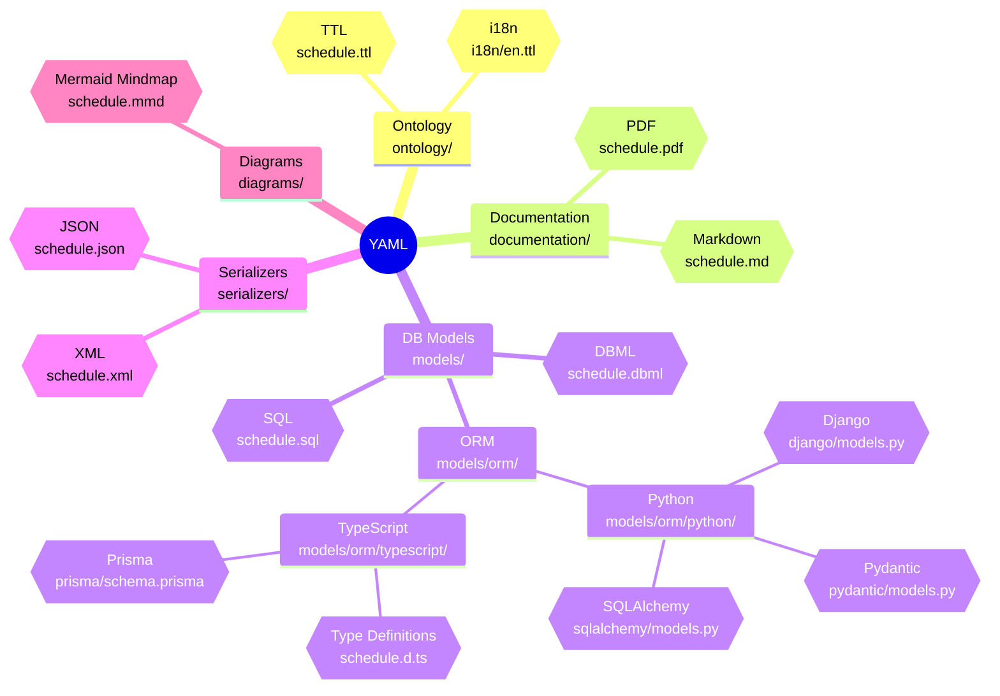

# GTFS Schedule Reference Generator

This project uses a single YAML source-of-truth to generate and share the GTFS Schedule reference across multiple formats. The YAML drives automated outputs for ontology, documentation, database models, serializers, and diagrams.

## Overview

- **YAML Ground Truth**: Canonical reference for GTFS Schedule.
- **Generated Outputs (planned)**: TTL, Markdown, PDF, DBML, SQL, Django ORM, Pydantic Types, SQLAlchemy ORM, TypeScript Type Definitions, Prisma ORM, JSON, XML, and Mermaid.
- **Validation**: JSON Schema for structure; ontology with SHACL shapes for semantic constraints.

## Convert a GTFS feed to RDF

The schedule converter accepts an HTTP(S) URL or a local ZIP and writes a single
`feed.ttl`, ready to import into QLever or another Turtle-compatible triple store:

```bash
uv run python converters/schedule/gtfs2ttl.py \
  https://feeds.simovi.org/incofer/schedule/gtfs.zip \
  --output-dir ./output/incofer \
  --base-iri https://feeds.simovi.org/incofer/schedule/rdf/

uv run python converters/schedule/gtfs2ttl.py ./gtfs.zip --output-dir ./output
```

The converter reads [schedule.yaml](serializers/schedule/schedule.yaml),
[fieldtypes.yaml](serializers/schedule/fieldtypes.yaml), and
[relations.yaml](serializers/schedule/relations.yaml). Each record gets its table's
ontology class and a feed-scoped IRI based on its primary key (including composite
keys). Full-row keys and omitted optional IDs use a hash of the record; singleton
tables use one fixed identity. Without `--base-iri`, the namespace includes the ZIP's
SHA-256 hash. Set an explicit namespace to retain record IRIs across feed updates;
use different namespaces for different feeds.

- IDs remain strings, including leading zeros. Numbers use `xsd:integer` or
  `xsd:decimal`; URL fields are IRIs. Dates (`YYYYMMDD`) and GTFS times (including
  values beyond 24 hours) retain their string representation, matching the shapes.
- Empty cells are omitted, not converted to empty literals or default values.
- Foreign IDs remain literal field values, **and** named object links and their
  inverses are emitted explicitly. QLever does not need OWL reasoning for these
  joins. Non-unique target keys link to every matching record: e.g. a trip links to
  all its shape-point records, since the current ontology models each as a `Shape`.
- Translation links respect `table_name` and the stop-time composite record key.
- GeoJSON features become `Location` instances; nested objects and arrays are
  preserved using blank nodes and RDF lists, with a separate FeatureCollection node.
- Unknown columns are preserved as strings with warnings. Unknown files are
  skipped with warnings. Missing foreign-key targets are reported, their ID values
  retained, and no placeholder records are invented.

Records and foreign-key indexes are held in memory; triples are written
incrementally. ZIP members are read without extraction. A failed conversion
preserves any existing `feed.ttl`. This is a conversion step, not full GTFS
validation: requiredness, numeric bounds, and other constraints can be checked
separately with [the SHACL shapes](ontologies/schedule/shapes.ttl). The output
contains instance data, not a copy of the ontology or shapes.

Example query after loading the output into QLever:

```sparql
PREFIX gtfs: <http://gtfs.simovi.org/schedule#>

SELECT ?agency ?routeName (COUNT(?trip) AS ?trips) WHERE {
  ?operator a gtfs:Agency ;
      gtfs:agency_name ?agency ;
      gtfs:operatesRoute ?route .
  ?route gtfs:route_long_name ?routeName ;
      gtfs:hasTrip ?trip .
}
GROUP BY ?agency ?routeName
```

## Conversion Overview



## Outputs & Locations

- **Ontology (TTL)**:
  - ontology/schedule.ttl
  - multilingual overlays in ontology/i18n/en.ttl, es.ttl, pt.ttl.
- **Docs (MD/PDF)**:
  - documentation/schedule.md
  - documentation/schedule.pdf
- **DB Models**:
  - DBML: models/schedule.dbml
  - SQL: models/sql/schedule.sql
  - Django ORM: models/orm/python/django/models.py
  - Pydantic Types: models/orm/python/pydantic/models.py
  - SQLAlchemy ORM: models/orm/python/sqlalchemy/models.py
  - TypeScript Types: models/orm/typescript/schedule.d.ts
  - Prisma ORM: models/orm/typescript/prisma/schema.prisma
- **Serializers**:
  - JSON: serializers/schedule.json
  - XML: serializers/schedule.xml
- **Diagrams**:
  - Mermaid: diagrams/schedule.mmd.

## Project Structure

```
├── diagrams/
│   └── schedule.mmd
├── documentation/
│   ├── realtime.md
│   └── schedule.md
├── models/
│   ├── schedule.sql
│   ├── schedule.dbml
│   └── orm/
│       ├── python/
│       │   ├── django/
│       │   │   └── models.py
│       │   ├── pydantic/
│       │   │   └── models.py
│       │   └── sqlalchemy/
│       │       └── models.py
│       └── typescript/
│           ├── schedule.d.ts
│           └── prisma/
│               └── schema.prisma
├── ontology/
│   ├── schedule.ttl
│   └── i18n/
│       ├── en.ttl
│       ├── es.ttl
│       └── pt.ttl
├── reference/
│   ├── realtime.md
│   └── schedule.md
├── serializers/
│   ├── schedule.xml
│   ├── schedule.json
│   ├── schedule.schema.json
│   └── schedule.yaml
├── LICENSE
├── main.py
├── pyproject.toml
└── README.md
```

## Usage

### View & Convert YAML to JSON

```bash
# View the YAML ground truth
cat serializers/schedule.yaml

# Convert YAML to JSON
uv run ./converters/yaml2json.py

# Validate JSON against the schema (requires a validator)
npm install -g ajv-cli
ajv validate -s serializers/schedule.schema.json -d serializers/schedule.json
```

### Generate Other Artifacts

Artifact generation is orchestrated by dedicated scripts/tools per target (ORMs, docs, diagrams). Where applicable, outputs are written to the paths listed above. Refer to each generator’s instructions and `pyproject.toml` tasks if defined.

## Ontology Namespace

- **Prefix**: gtfs
- **URI**: http://ontology.gtfs.org/reference#

```turtle
@prefix gtfs: <http://ontology.gtfs.org/reference#> .
```

## Contributing

- Extend `serializers/schedule.yaml` to enrich the source reference.
- Keep `serializers/schedule.schema.json` aligned with structural changes.
- Add/adjust generators to produce new formats (e.g., Prisma, XML, PDF) into the paths above.
- For ontology i18n, add new overlays in ontology/i18n/ and ensure labels/comments use correct language tags.

## Status

The YAML-driven pipeline is actively expanding. Outputs listed above reflect the current set and planned locations where some artifacts are generated or expected.
