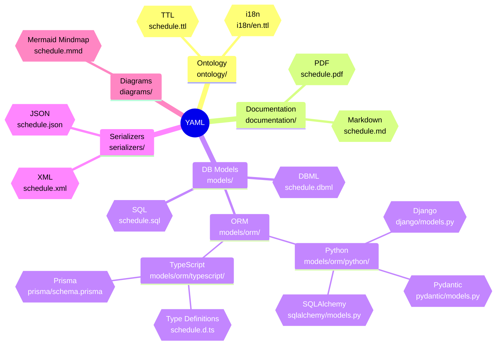

# GTFS Schedule Reference Generator

This project uses a single YAML source-of-truth to generate and share the GTFS Schedule reference across multiple formats. The YAML drives automated outputs for ontology, documentation, database models, serializers, and diagrams.

## Overview

- **YAML Ground Truth**: Canonical reference for GTFS Schedule.
- **Generated Outputs (planned)**: TTL, Markdown, PDF, DBML, SQL, Django ORM, Pydantic Types, SQLAlchemy ORM, TypeScript Type Definitions, Prisma ORM, JSON, XML, and Mermaid.
- **Validation**: JSON Schema for structure; ontology with SHACL shapes for semantic constraints.

## Conversion Overview



## Outputs & Locations

- **Ontology (TTL)**:
  - ontology/schedule.ttl
  - multilingual overlays in ontology/i18n/en.ttl, es.ttl, pt.ttl.
- **Docs (MD/PDF)**:
  - documentation/schedule.md
  - documentation/schedule.pdf
- **DB Models**:
  - DBML: models/schedule.dbml
  - SQL: models/sql/schedule.sql
  - Django ORM: models/orm/python/django/models.py
  - Pydantic Types: models/orm/python/pydantic/models.py
  - SQLAlchemy ORM: models/orm/python/sqlalchemy/models.py
  - TypeScript Types: models/orm/typescript/schedule.d.ts
  - Prisma ORM: models/orm/typescript/prisma/schema.prisma
- **Serializers**:
  - JSON: serializers/schedule.json
  - XML: serializers/schedule.xml
- **Diagrams**:
  - Mermaid: diagrams/schedule.mmd.

## Project Structure

```
├── diagrams/
│   └── schedule.mmd
├── documentation/
│   ├── realtime.md
│   └── schedule.md
├── models/
│   ├── schedule.sql
│   ├── schedule.dbml
│   └── orm/
│       ├── python/
│       │   ├── django/
│       │   │   └── models.py
│       │   ├── pydantic/
│       │   │   └── models.py
│       │   └── sqlalchemy/
│       │       └── models.py
│       └── typescript/
│           ├── schedule.d.ts
│           └── prisma/
│               └── schema.prisma
├── ontology/
│   ├── schedule.ttl
│   └── i18n/
│       ├── en.ttl
│       ├── es.ttl
│       └── pt.ttl
├── reference/
│   ├── realtime.md
│   └── schedule.md
├── serializers/
│   ├── schedule.xml
│   ├── schedule.json
│   ├── schedule.schema.json
│   └── schedule.yaml
├── LICENSE
├── main.py
├── pyproject.toml
└── README.md
```

## Usage

### View & Convert YAML to JSON

```bash
# View the YAML ground truth
cat serializers/schedule.yaml

# Convert YAML to JSON
uv run ./converters/yaml2json.py

# Validate JSON against the schema (requires a validator)
npm install -g ajv-cli
ajv validate -s serializers/schedule.schema.json -d serializers/schedule.json
```

### Generate Other Artifacts

Artifact generation is orchestrated by dedicated scripts/tools per target (ORMs, docs, diagrams). Where applicable, outputs are written to the paths listed above. Refer to each generator’s instructions and `pyproject.toml` tasks if defined.

## Editor Annotations (UI & Validation)

Beyond the GTFS spec itself, the repo records **which visual component edits each
field and what validation it needs**. That mapping is the lab's own decision, not
part of GTFS, so it lives in a companion file rather than inside the ground truth:

- **Annotations**: `serializers/schedule/schedule.ui.yaml`, keyed by `<file>.<field>`
- **Schema for the annotations**: `serializers/schedule/schedule.ui.schema.json`
- **Design rationale (Spanish)**: `documentation/ui-schema.md`

Keeping them separate means `schedule.yaml` can be regenerated from an upstream
spec change without colliding with editor decisions.

```bash
# Report how much of the spec has editor annotations
uv run converters/schedule/ui_coverage.py
uv run converters/schedule/ui_coverage.py --json

# Build the browsable explorer into web/dist/index.html
uv run converters/schedule/yaml2site.py

# Build it, preview it at http://localhost:8777, and edit annotations there
uv run converters/schedule/serve_site.py
uv run converters/schedule/serve_site.py --read-only   # preview without write-back
```

The coverage script fails on orphaned or schema-invalid annotations, but not on
fields that simply have no annotation yet — those are expected while the sweep
across the spec is in progress, and are surfaced in the site as "not yet mapped".

### Editing annotations from the site

The explorer can also write annotations, not just display them. Its form is
generated from `schedule.ui.schema.json`, so the component vocabulary and the
validation rules never exist in two places.

Edits are held as an overlay in the browser's `localStorage`, separate from the
data built into the page; the difference between the two is the changeset, which
is what drives the "new/modified/removed" badges and the export.

How the changeset leaves the browser depends on where the page is running:

- **On GitHub Pages** there is no server, so the page emits a YAML *patch* —
  only the changed entries — to copy or download and paste under `fields:`. A
  patch rather than a whole file on purpose: a full-file export would silently
  drop the hand-written comments in `schedule.ui.yaml` that record why a given
  rule is a warning and not an error.
- **Under `serve_site.py`** a "write to file" button appears. It merges the
  changeset into `serializers/schedule/schedule.ui.yaml` through ruamel's
  round-trip loader, so comments on untouched entries survive. The endpoint
  writes only that one file, only accepts same-origin requests from the local
  server, and validates the whole document against the schema before writing.

The browser's own checks are for fast feedback only. `ui_coverage.py` in CI
remains the authority on whether the annotations are valid.

## Display Composites

Which GTFS fields each **screen** reads. This is the transpose of the editor
annotations: `schedule.ui.yaml` has one entry per field, `composites.yaml` has
one entry per screen naming many fields.

- **Composites**: `serializers/ui/composites.yaml`
- **Schema**: `serializers/ui/composites.schema.json`
- **Design rationale (Spanish)**: `documentation/composites.md`

This file is **not** part of GTFS and the spec implies none of these screens —
it is SIMOVI's presentation layer, which is why it lives in its own directory.

A prop's `sources` is an ordered fallback chain, first non-empty wins:

```yaml
- name: eta
  sources:
    - realtime:TripUpdate.stop_time_update.departure.time
    - schedule:stop_times.departure_time
```

That chain is the realtime-to-static degradation policy, written down once
instead of reimplemented in every screen.

```bash
# Resolve every reference against the spec and report; non-zero on a dangling ref
uv run converters/ui/composites.py

# Build the composites page into web/dist/composites.html
uv run converters/ui/composites2site.py

# Build both pages, serve them, and edit composites.yaml from the browser
uv run converters/schedule/serve_site.py
```

### Editing composites from the page

The page edits composites, views and derived sources — no hand-editing of the
YAML. Edits are held as an overlay in `localStorage`, separate from the data
built into the page; the difference between the two is the changeset, which
drives the "new/modified/removed" badges and the export.

Every reference input offers all 869 possible references (218 Schedule fields,
650 Realtime paths), embedded already-resolved, and marks immediately whether
what you typed exists. That same catalog lets the whole page — wireframe,
counters, reverse index — re-render from an unsaved draft.

Under `serve_site.py` a "write to file" button merges the changeset into
`serializers/ui/composites.yaml` through ruamel's round-trip loader, so comments
on untouched entries survive. The endpoint accepts same-origin requests only,
and validates the whole merged document against the schema *and* resolves every
reference before writing. On GitHub Pages there is no server, so the page emits
a YAML patch to copy instead. `composites.py` in CI remains the authority.

Because both files key into the same field namespace, the field explorer shows
which screens display a given field, and the composites page reports which
displayed fields still have no editor annotation — that list is the annotation
priority order.

Current scope is `/routes` only: the seven blocks from the 2026-09-10 lab
proposal — `RouteHeader`, `RouteNextTrips`, `RouteSchedule`, `RouteStops`,
`RouteMap`, `RouteFares` (Fares v2), `RouteAlerts` — in that order.

## Ontology Namespace

- **Prefix**: gtfs
- **URI**: http://ontology.gtfs.org/reference#

```turtle
@prefix gtfs: <http://ontology.gtfs.org/reference#> .
```

## Contributing

- Extend `serializers/schedule.yaml` to enrich the source reference.
- Keep `serializers/schedule.schema.json` aligned with structural changes.
- Add/adjust generators to produce new formats (e.g., Prisma, XML, PDF) into the paths above.
- For ontology i18n, add new overlays in ontology/i18n/ and ensure labels/comments use correct language tags.

## Status

The YAML-driven pipeline is actively expanding. Outputs listed above reflect the current set and planned locations where some artifacts are generated or expected.
